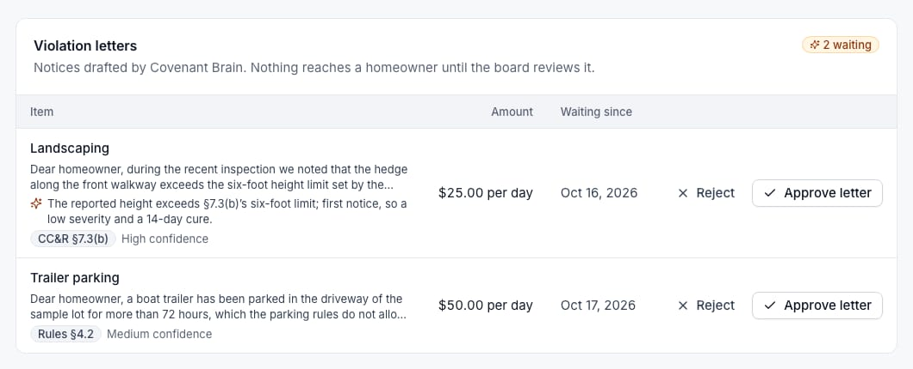
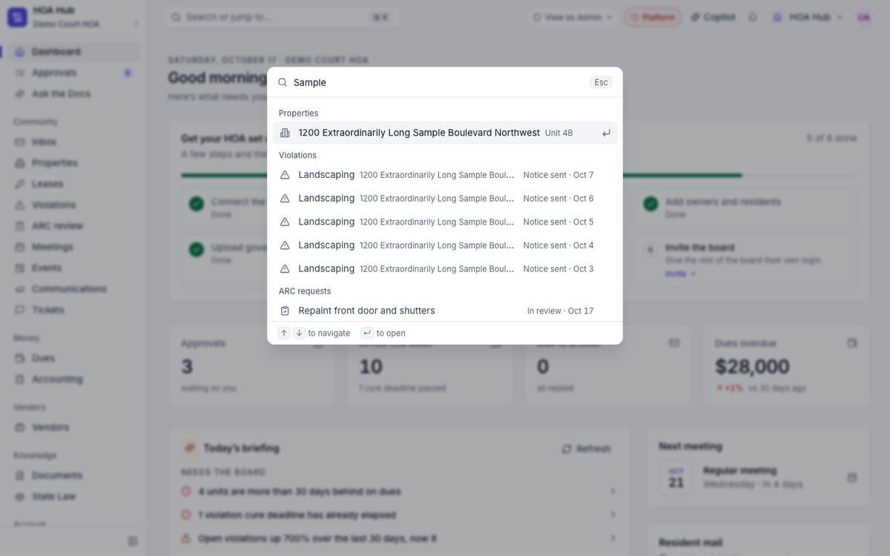
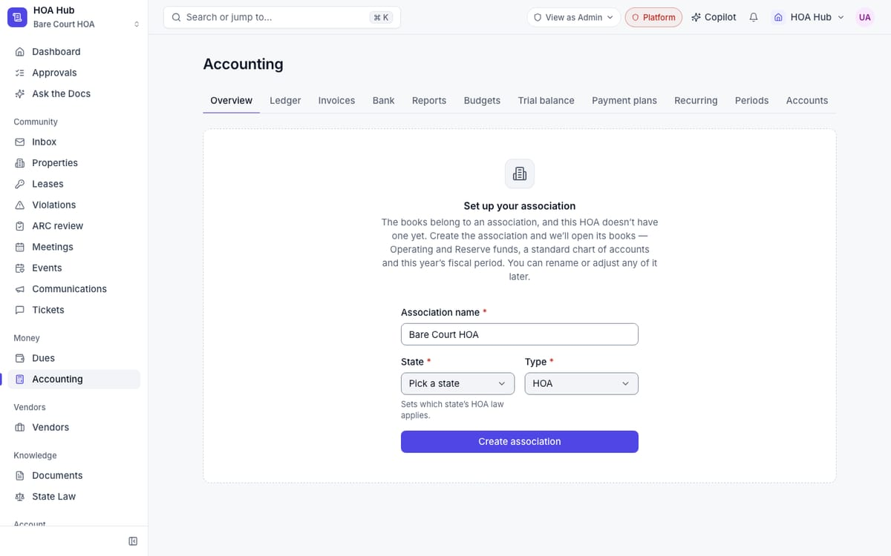
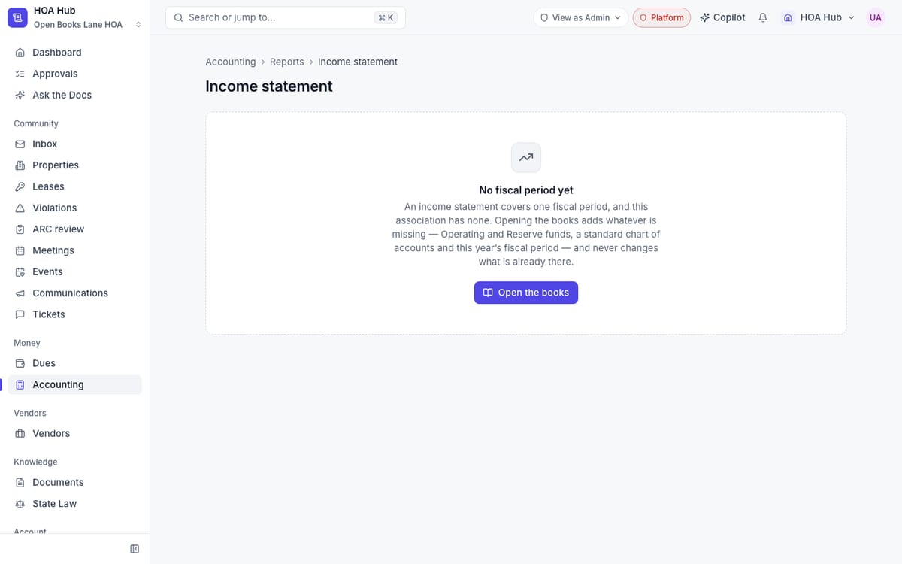

## Summary

Boards can now approve or reject violation letters and AI-read vendor bills straight from the Approvals page, and nothing is sent or entered until someone clicks approve. The search box (⌘K) now finds actual records — owners, units, violations, ARC requests, tickets, documents and meetings — not just pages. A new association can set itself up and open its books from inside Accounting, and dates across the app now follow the association's own time zone.

## What's new

### Approvals
- Violation letters drafted by Covenant Brain wait in Approvals. Approve to file the violation, or reject it. Approving never emails the homeowner by itself.
- Scan a bill (Accounting → Invoices → New) and the AI reads it into a "Bills to enter" approval: vendor, invoice number, dates, total and expense account. Approving enters it in accounting. Anything the AI was unsure of is marked "Check".
- Vendors can now be rejected as well as approved, and the vendor counts are per association. A vendor is no longer counted twice in the badge.
- The violation approval queue now has its own Approve letter and Reject buttons. Reject asks for a reason.
- Only board members and admins can approve a vendor.

### Search
- ⌘K (Ctrl+K on Windows) searches records: owners, units, violations, ARC requests, tickets, inbox threads, vendors, documents and meetings.
- Each result shows its status and date, so five "Landscaping" violations are easy to tell apart.
- Record search is for board members only. Residents don't get it.

### Accounting
- An HOA without an association gets a "Set up your association" form right in Accounting. It creates the association, its Operating and Reserve funds, a standard chart of accounts and this year's fiscal period.
- An association whose books are incomplete gets an "Open the books" button on every report and page that needs a fiscal period. It adds only what's missing and never changes what's already there.

### Dates and time zones
- "Today" is now the association's day, based on its state. Due dates, reminders, events, recurring journal entries, form date defaults and the heat map no longer roll over at midnight UTC (8 PM in Florida).

## Fixes

- Spreadsheet exports (CSV) are now protected against formula injection. A cell that starts with `=`, `+`, `-` or `@` can no longer run as a formula when the file is opened in Excel.
- Invitation pages show a "try again" option when something goes wrong, instead of a dead end, and error messages no longer show internal details.
- Exports, invoice payment entry, payment plans and the platform metrics no longer stop at 1,000 rows.
- The platform-admin document count counted every tenant's documents. It now counts the right ones.
- The inbox's property link opened a "not found" page. It now opens the property.
- On the platform analytics page, the chart legends now fit inside their cards.
- An annual event only moves to next year after its reminder has actually been delivered.

## Under the hood

- Every API route now follows the same conventions: consistent JSON error responses, checked configuration, and no internal details in errors. Round 1 through round 4 are done.
- A flaky integration test was traced to the Mac going to sleep in the middle of a run and two runs sharing one test database. Both are fixed, and the test suite now runs clean every time.
- Platform analytics counts units and members without reading every row, so the page stays fast as tenants grow.
- More than 3,700 unit tests and 348 integration tests, all passing before this deploy.

## Needs your action

- Try Scan a bill on one real vendor bill and check the fields it fills in. So far bill scan has only been tested against a test model, not the live AI.

## Screenshots

