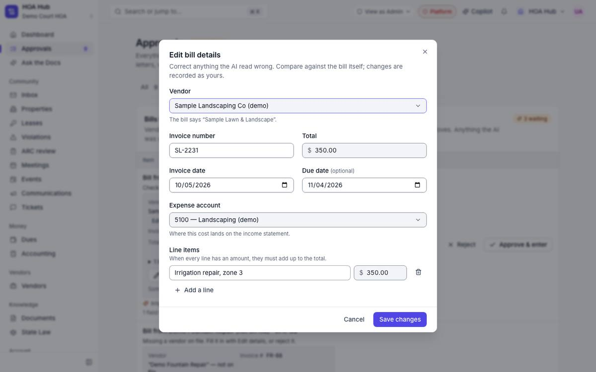
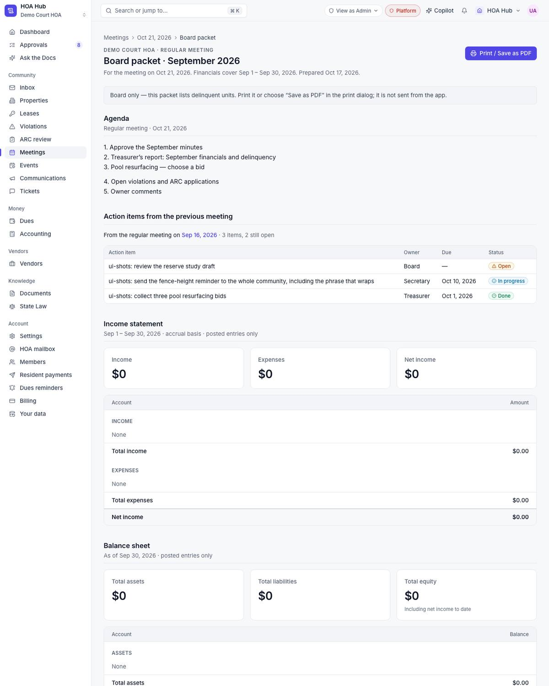

## Summary

The board packet now reports the month it covers: budget-vs-actual and delinquency stop at the last day of that month, using the association's own time zone. Owner email and phone numbers no longer go to the AI provider. Scanned bills can be corrected before anyone approves them. A sign-in link can no longer be used to send someone to another website.

## What's new

### Board packet
- Budget vs. actual counts entries through the last day of the packet month, not through today. The section says so ("through Sep 30, 2026").
- Delinquency is "as of" the end of the month. Charges due later, and payments made after month end, no longer change the September picture.

### Approvals: scanned bills
- Each bill has an **Edit details** button. You can fix the vendor, invoice number, dates, total, expense account and line items before you approve.
- Every edit is re-checked: the dates must make sense, the total must add up, the account must be one of yours, and a duplicate invoice is refused.
- A bill that was missing something can be completed instead of rejected. Edited fields are marked so the board can see what a person changed.

### Privacy with AI
- When the community assistant looks up an owner, the AI only sees placeholders. Board members still get the real email and phone in the answer, filled in on our server.
- Reply drafts for the HOA inbox remove email addresses and phone numbers from resident messages before the AI reads them.
- Vendor onboarding no longer sends the vendor's legal name, tax ID or address to the AI.

## Fixes

- A filtered link, such as Approvals → Bills, now still opens on that filter after you sign in.
- The vendor picker on a scanned bill now shows its placeholder instead of a blank box.
- Long resident emails no longer break the inbox's document and state-law lookups.

## Under the hood

- Sign-in links only redirect to pages on our own site, which closes an open-redirect hole.
- Research and a phased plan for rebuilding the Properties module. The first part is already merged for the next release: every home becomes one record that dues, notices and the portal all agree on.
- New roadmap items: module switches per tenant with per-module pricing, and a monthly state-law sync with an emailed report.

## Needs your action

- Add the GitHub secrets `RESEND_API_KEY`, `RELEASE_NOTES_TO` and `RELEASE_NOTES_FROM` so these notes arrive by email.

## Screenshots

