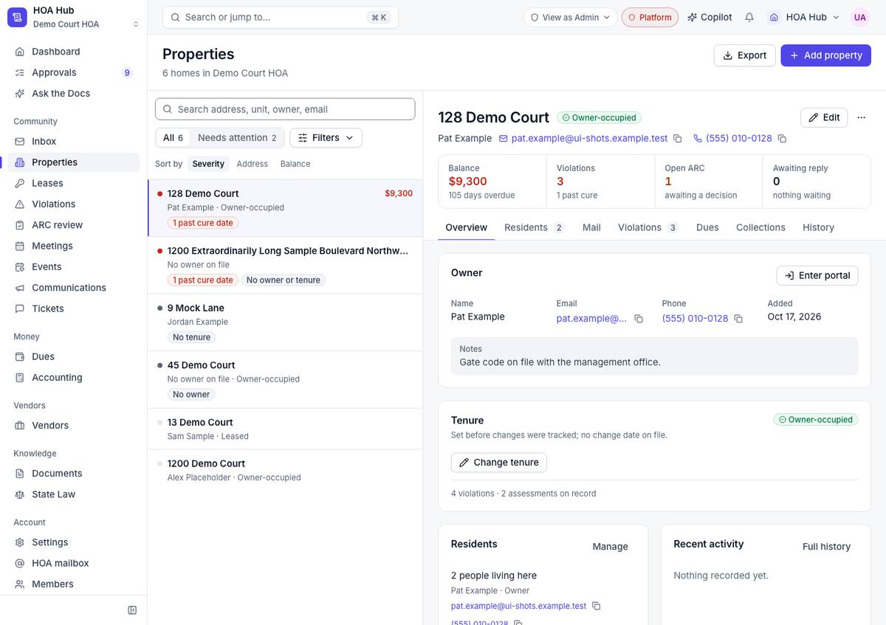
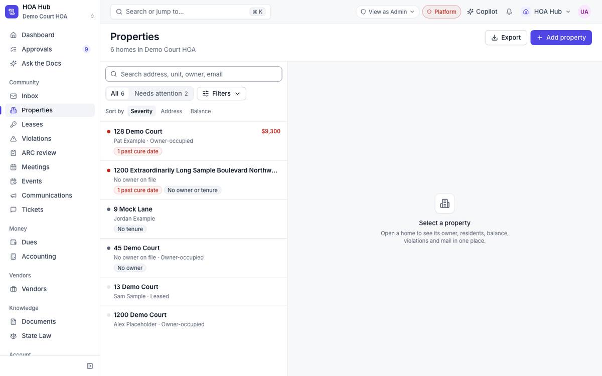
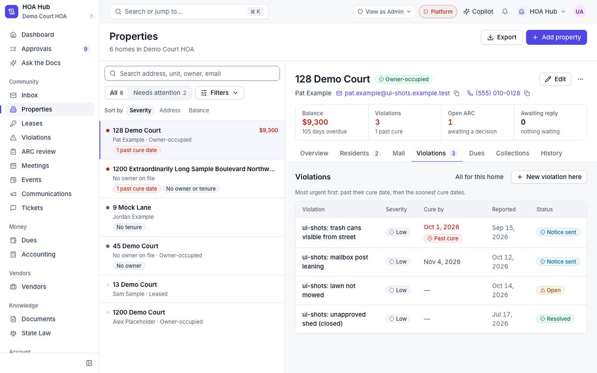
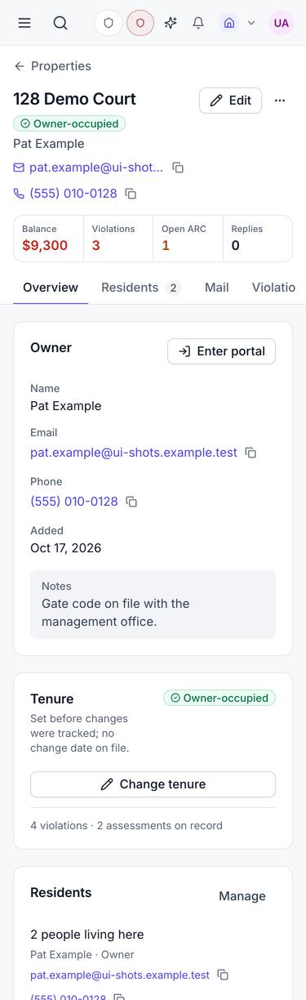

## Summary

This is the first part of the Properties rebuild. Each home is now one record that dues, notices and the resident portal all read, so a home you add can be billed straight away. Searching the Properties list now looks through every home, not only the ones that need attention. Owners can be called or emailed with one tap, and addresses across the app link back to their property.

## What's new

### Properties list
- **All** is the default view, with **Needs attention** one click away. Search covers every home.
- The filter buttons are now a single **Filters** menu (incomplete record, waiting list, owner-occupied, leased, tenure unknown).
- House numbers sort the way you'd expect (128 before 1200).
- Export downloads exactly what you're looking at, filters and search included.
- The "missing data" badge says what's missing ("No owner", "No tenure").

### Property page
- Owner and resident phone numbers and emails can be tapped to call or email, and copied with one click.
- The four numbers at the top (Balance, Violations, Open ARC, Awaiting reply) each open the matching page, filtered to this home.
- The Violations tab has a **Cure by** column, puts past-cure items first, and has a **New violation here** button.
- **Delete** is now **Archive**, in the ⋯ menu. It warns you if the home still has a balance or open violations.
- On a phone the header is compact, and the tabs stay at the top as you scroll.

### Everywhere else
- Addresses on Violations, a violation's page and Dues link to their property.
- Links from a property open Violations, Dues and Leases already filtered to that home.
- Reporting a violation no longer picks a home for you. You search for the home, or it comes pre-filled when you start from the property page.

## Fixes

- **Adding a property now creates everything the home needs.** Before, a home added on the Properties page couldn't be billed, mailed or put into collections. Now dues, notices and the resident portal can use it straight away, and the page opens on the new home with "Property added."
- Editing an owner's name or email on a property now also changes who receives notices and dues reminders.
- Archiving a home now takes it out of dues and notices.
- **Generate dues** no longer stops with "Add units before generating assessments" when your homes were added in the app.
- A filtered link (for example Properties → Needs attention) still opens on that filter after you sign in.

## Under the hood

- One rule decides which billing record belongs to which home, and a check stops new code from bypassing it.
- The board's roster import now writes both records too, which retires two manual scripts.

## Screenshots

