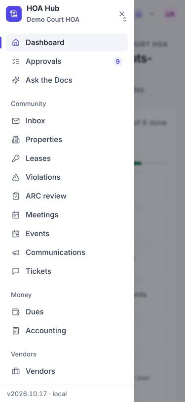
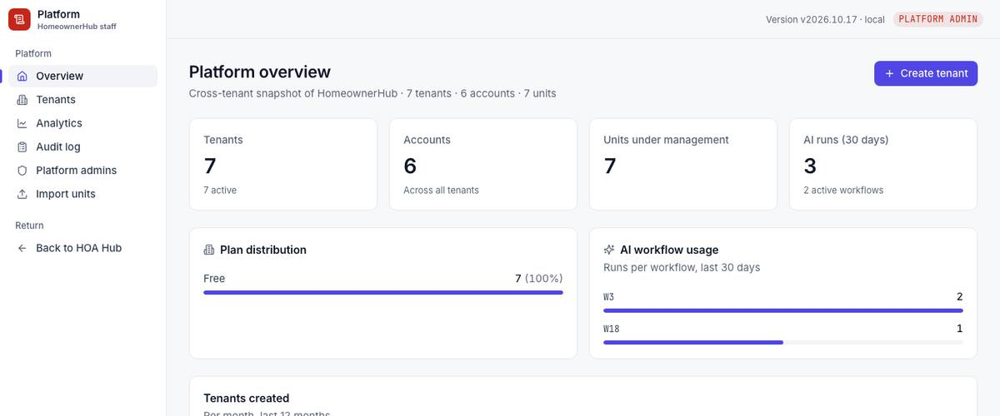

## Summary

Every screen now shows which version of HomeownerHub is running, for example "v2026.10.17 · 809b442". A new What's new page lists every release in plain language, newest first. When you report a problem, you can tell us exactly which version you saw.

## What's new

### Version label
- At the bottom of the sidebar and the phone menu. Select it to open What's new.
- On the sign-in screens, at the bottom of the resident portal, and in the platform-admin header.
- It always matches what the server reports, so it shows exactly what's deployed.

### What's new page
- Lists each release's summary, newest first. It is the same text as the release-note email.

## Under the hood

- One source for the version, shared by the app and the health check used to verify deploys.

## Screenshots

