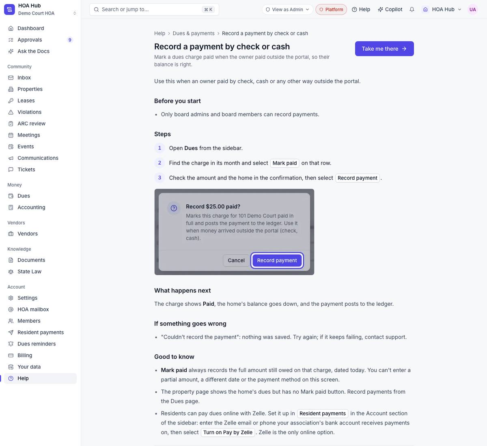
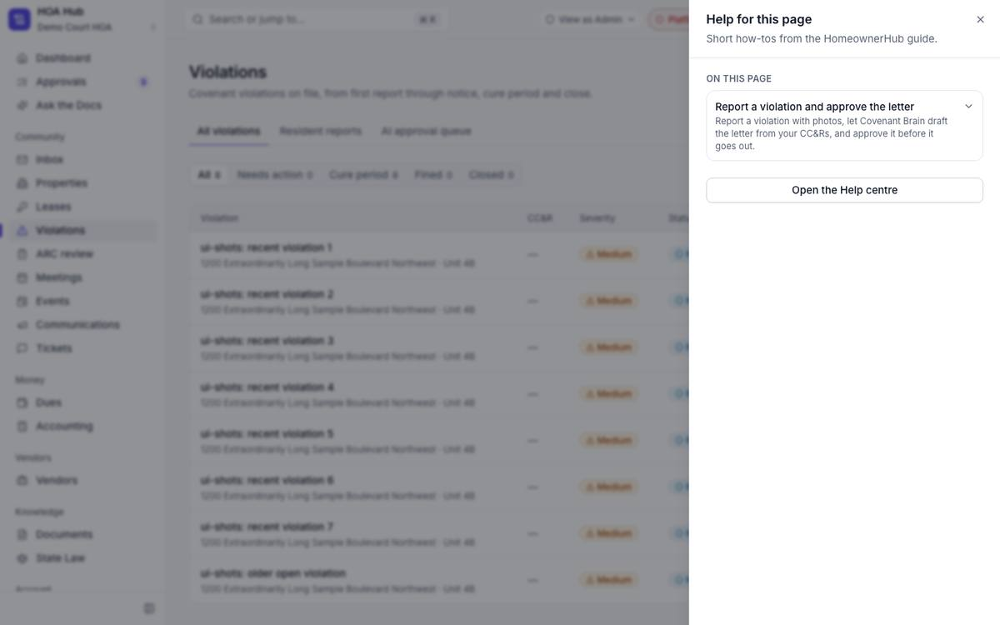
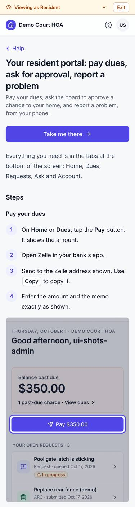

## Summary

HomeownerHub now has its own user guide. A Help centre covers the 12 jobs a new board does first, from setting up your HOA to residents paying dues on a phone. Each job is a short article with numbered steps and screenshots of the real screens. A "?" button on every page shows the articles for that page, and "Take me there" opens the right screen.

## What's new

### Help centre
- Open **Help** from the sidebar (it's in ⌘K too).
- Search shows results as you type. Articles are grouped by topic, with a "Start here" path for new boards.
- 12 articles:
  - set up your HOA;
  - add properties and residents;
  - invite the board;
  - bill this month's dues;
  - record a check or cash payment;
  - report a violation and approve the letter;
  - review an ARC application;
  - schedule a meeting, prepare the packet and add minutes;
  - the Approvals queue;
  - send an announcement;
  - governing documents and Ask the Docs;
  - the resident portal.
- Every article has a **Take me there** button that opens the screen it describes.

### Help on every page
- Select **Help** in the top bar, or press **Shift + /**, to open the articles for the page you're on. Each article opens right there in the panel.

### For residents
- Residents have their own Help pages in the portal, written for phones.

## Under the hood

- The guide stays accurate as the app changes. A check stops every release if an article names a button, page or screenshot that no longer exists.

## Screenshots

