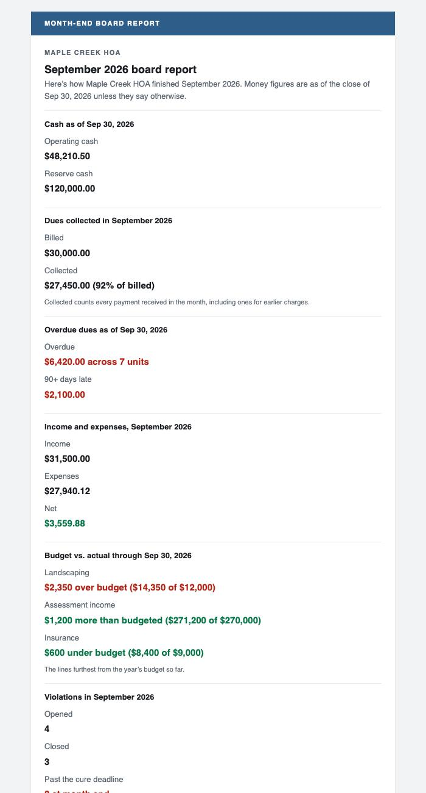

## Summary

Moving between pages should now feel noticeably faster. The app's servers moved next to the database, and each page asks the database far fewer questions. On the 1st of every month, each board also gets an email report on how the community finished the previous month: cash, dues collected, overdue balances, the budget, violations and what's waiting on the board.

## What's new

### Faster navigation
- The servers that build each page now run in the same region as the database, in the Pacific Northwest. They used to run on the East Coast, so every lookup crossed the country.
- A page change used to repeat the same sign-in and membership lookups many times (up to 18 trips on a property page). Now it does each once, and runs the rest at the same time.
- Selecting a sidebar link shows the loading screen immediately, and the page fills in when it's ready.

### Month-end board report
- Sent automatically on the 1st at 8 AM to the HOA's board and admin members, covering the previous month in the association's own time zone. Residents never receive it.
- Contents:
  - cash on hand;
  - dues billed vs. collected;
  - overdue dues, including 90+ days;
  - income and expenses;
  - the budget lines furthest from plan;
  - violations opened, closed and past cure;
  - architectural requests;
  - approvals waiting;
  - the next meeting, with a link to the full board packet.
- **Accounting → Reports** has a new Monthly board report card. Preview last month's email there; admins can also **Send now**.
- Each person can turn it off under **Settings → Notifications**.
- If a section couldn't be loaded, the email says so instead of showing zeros.

## Under the hood

- The sign-in check that runs before each page now verifies your session on the server without an extra network call. The database still checks access on every request.

## Screenshots

