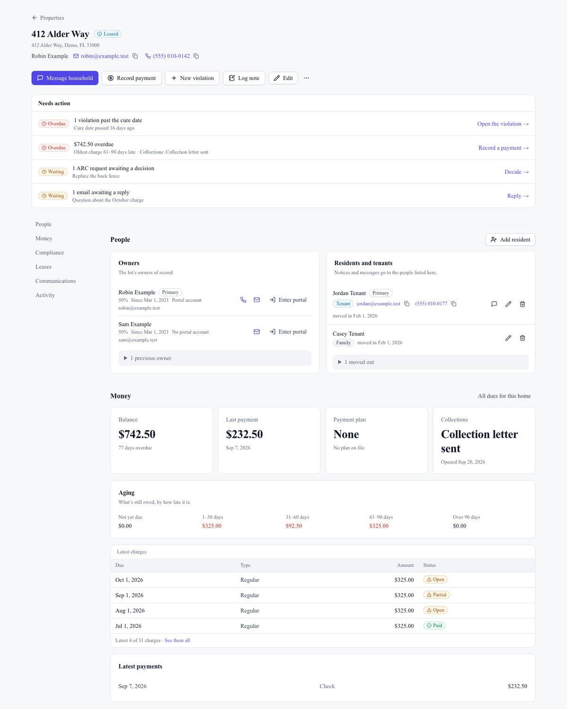
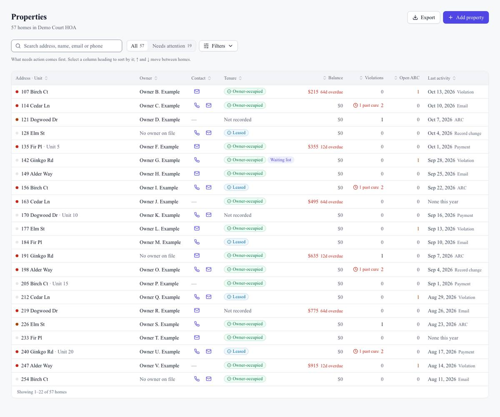
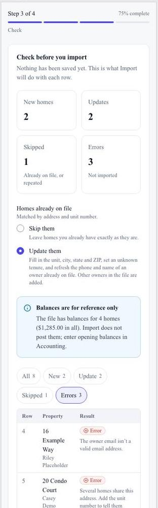
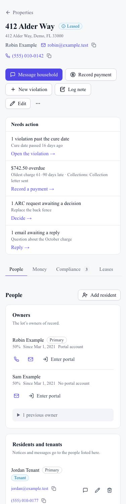

## Summary

The Properties module is now a full workspace. The list is a full-width table you can sort by any column. Each home's page shows everything about it on one screen: owners and residents, money, violations and ARC, leases, mail and a full timeline, with the next actions at the top. Boards can now also import their own roster from a spreadsheet, including a CINC export, with a preview before anything is saved.

## What's new

### Properties list
- A full-width table, sortable by any column: address, owner, contact, tenure, balance and days overdue, violations (with "past cure" in red), open ARC and last activity.
- Move through it with the arrow keys or J/K. Select a row to open the home.
- Search now also finds a home by a resident's name, email or phone, or by the owner's phone.
- On a phone, each home is a card with its balance, its most urgent issue, and tap-to-call.

### Property page
- **Actions at the top:** Message household, Record payment, New violation and **Log note** (a dated note on the home's history, visible to the board only).
- **Needs action:** violations past cure, overdue balance with its age, ARC requests waiting on you, and mail waiting for a reply. Each one links straight to the fix.
- **One page with every section:**
  - People: owners with their share and portal status, previous owners, residents and tenants.
  - Money: balance, aging, latest charges and payments, payment plan, collections.
  - Compliance: violations with cure dates, and ARC requests.
  - Leases and waiting list.
  - Mail and notices.
  - One merged activity timeline.

### Import your roster
- **Properties → Import:** upload a CSV or Excel file and match its columns (CINC exports are recognised automatically). See exactly what will happen to each row (new home, update, skipped, error with the reason), then import.
- You choose whether homes already on file are skipped or updated.
- Balances in the file are shown for reference but never posted.
- Large files import in batches with a progress bar. Rows that failed can be downloaded as a CSV to fix and re-import.
- A template file is available to download.

## Fixes

- The setup checklist's properties step links to the new import, instead of asking you to contact support.

## Screenshots

