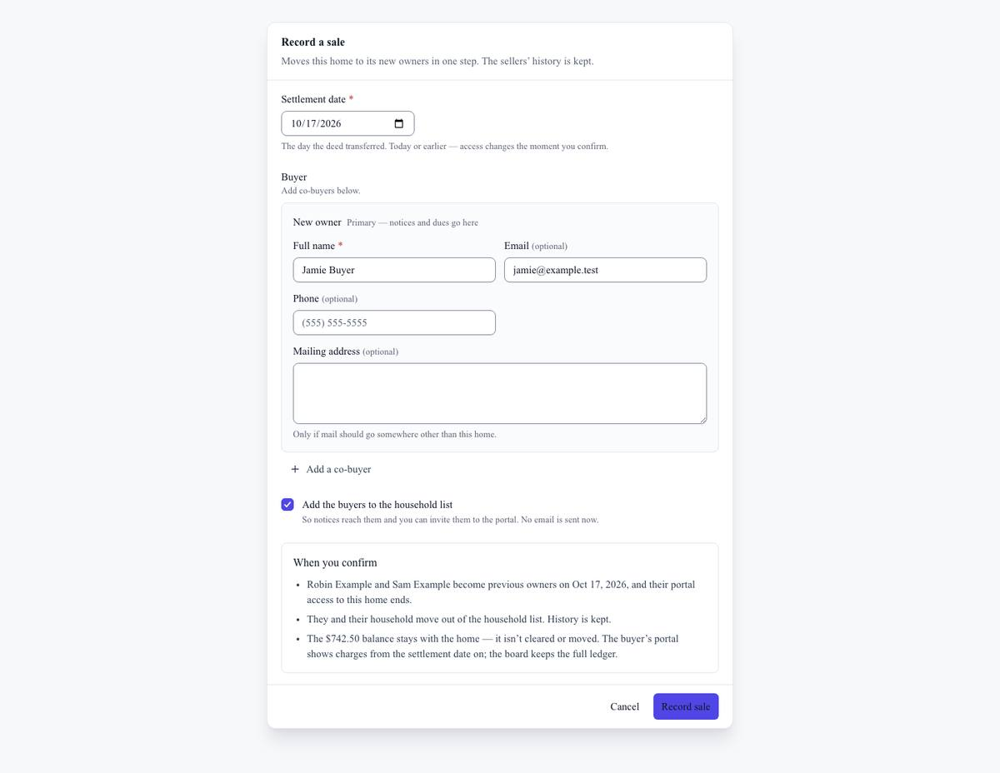
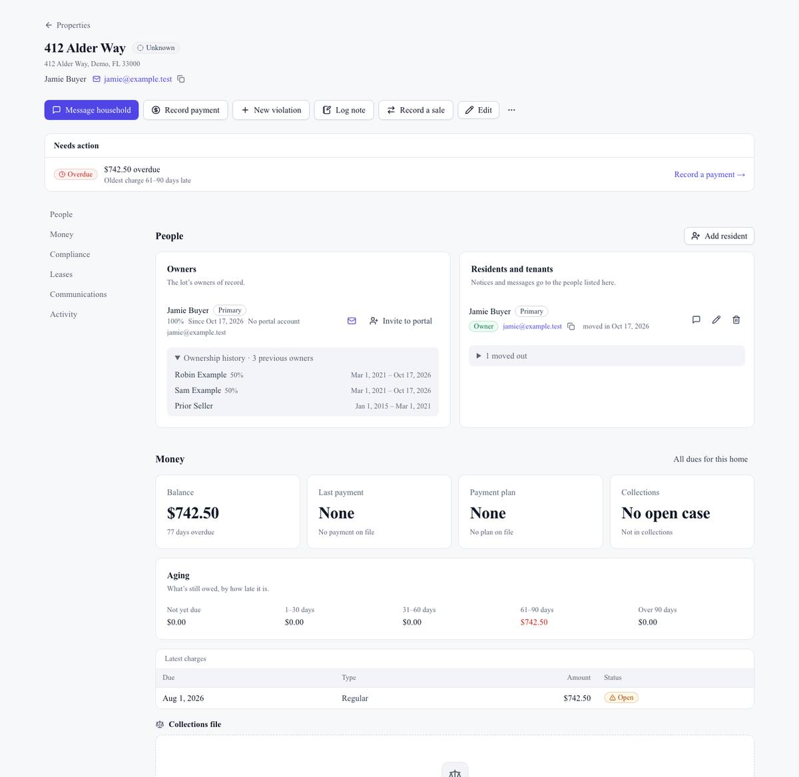

## Summary

When a home sells, the board can now record the sale in one step. The sellers become previous owners and lose portal access to that home. The buyers become owners from the settlement date, and the home's balance stays with the home. The public website was also checked line by line, so every feature and price on it matches what HomeownerHub does today.

## What's new

### Record a sale
- On a property page, choose **Record a sale**. Enter the settlement date and the buyer or buyers (shares must add up to 100%), and say whether the tenants stay.
- When you confirm:
  - the sellers become previous owners, and their portal access to this home ends;
  - the buyers become owners from the settlement date;
  - the balance stays with the home.
- In the portal, buyers only see charges from the settlement date on. The board keeps the full ledger.
- Buyers can be added to the household list. **Invite to portal** sends nothing until you choose it.
- The People section shows ownership history with dates, and the activity timeline records the sale.

### Public website
- One price everywhere, the same one checkout charges: $4.99 per door per month (41-door minimum), or $4.49 a month on the annual plan.
- Features that aren't built yet are now listed as roadmap, not as things you get today.
- The new features are described: roster import, the user guide and Ask the guide, the month-end board report, AI bill scan and one-click violation letters.
- Example testimonials that read as real customers were removed. Only the real Madison Park quote remains.

## Fixes

- Inviting an owner to the portal no longer creates a second ownership record dated the day of the invite.

## Under the hood

- Screenshots now run in GitHub's automated checks rather than on a local machine, and out-of-date guide screenshots are refreshed automatically.

## Needs your action

- The next SQL batch includes one more rule that blocks buyers from reading the seller's charges at the database level. The app already hides them.

## Screenshots

