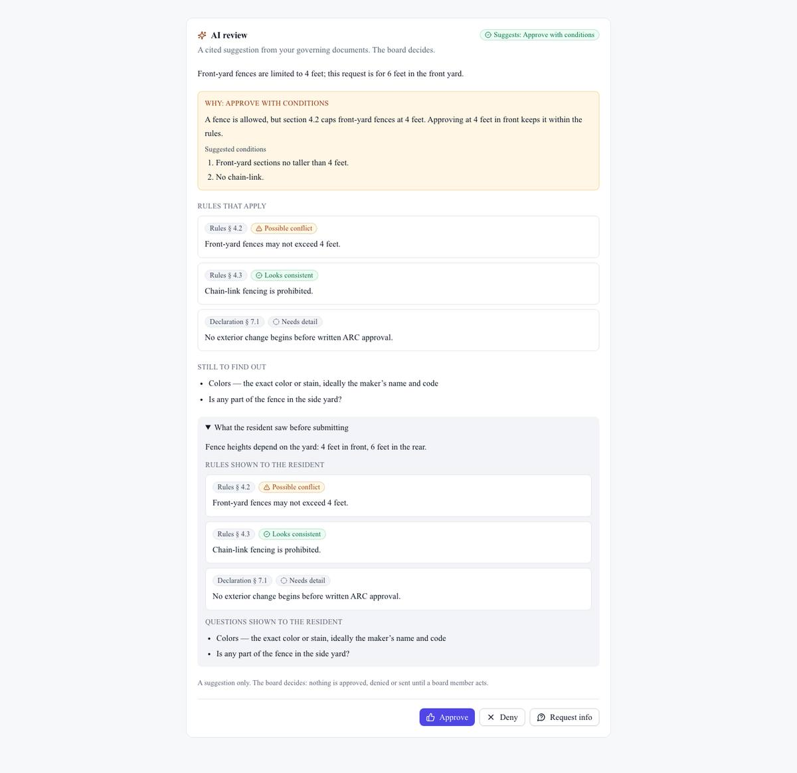
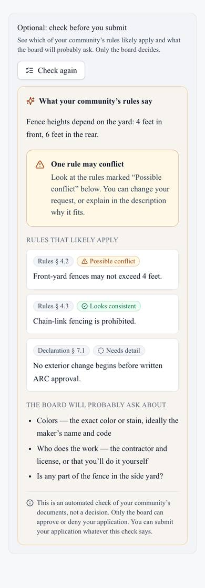
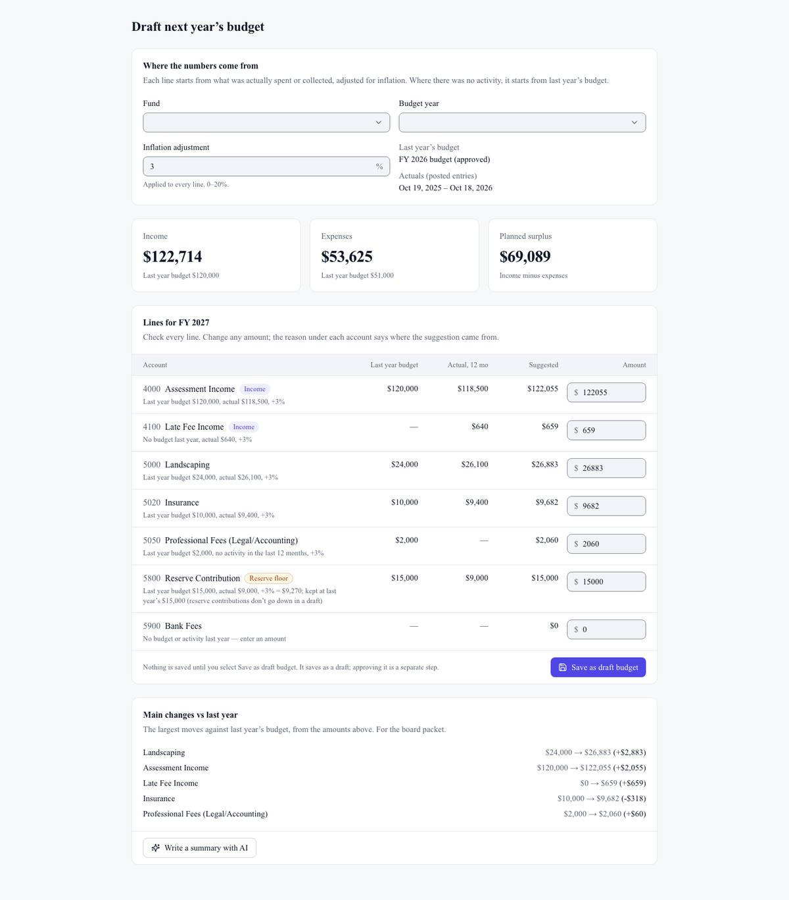

## Summary

Residents can now check an architectural (ARC) request against the HOA's rules before they submit it. The board gets an AI review of every new request, citing the exact rules. The AI only suggests; the board decides. Boards can also draft next year's budget from last year's numbers in one click. Prices in the app now match Stripe's charges to the cent.

## What's new

### Architectural requests
- **Residents:** on the request form, **Check my request against the rules** shows the rules that likely apply (with the section), possible conflicts, and what the board will probably ask about, such as dimensions, materials, colors, contractor and dates. It never approves anything, and the resident can always submit.
- **Board:** each new request gets an **AI review**. It shows a suggestion (approve, approve with conditions, deny, or need more information), the reasoning, suggested conditions, each cited rule marked as fits or possible conflict, and what the resident was shown before submitting.
- New requests also appear under **ARC reviews** in Approvals. **Approve**, **Deny** and **Request info** start from the AI's draft text, which you can edit.
- If no rule clearly applies, the AI says so instead of guessing.

### Budget first draft
- **Accounting → Budgets → Draft next year's budget** proposes each line from the last 12 months of actuals (or last year's budget where there was no activity), plus an inflation % you choose (3% by default).
- The reserve contribution is never set below last year's.
- Every line explains itself, for example "Last year budget $24,000, actual $26,100, +3%".
- You review and edit every line, then save it as a draft budget. An optional summary lists the main changes from last year.

## Fixes

- **Billing:** the prices shown in Settings → Billing now always equal what Stripe charges (for example $9,698.40 a year at 180 doors). The minimum shows as "41-door minimum ($204.59/month)".
- **Vendors:** the search form no longer runs off the edge of a phone screen.

## Screenshots

