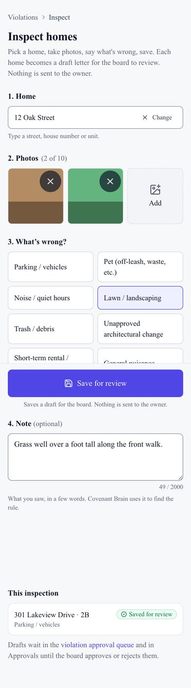
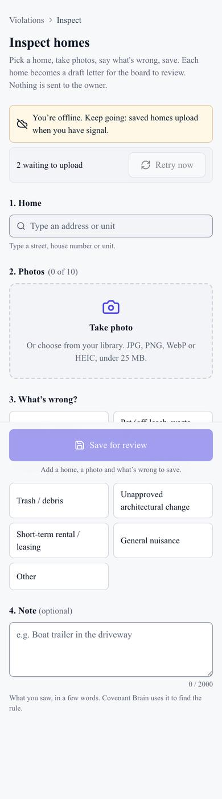

## Summary

Board members can now walk or drive the community with a phone and record problems as they go. For each home they pick the address, take photos, choose what's wrong and save. Each one becomes a draft violation letter for the board to review, and nothing goes to the owner. If the phone loses signal, the photos wait on the phone and upload by themselves later. The HOA inbox also got more dependable: failed attachments can be retried, and reconnecting a mailbox no longer downloads everything again.

## What's new

### Inspection mode
- Open **Violations → Inspect homes** (or search "Inspect" with ⌘K) on your phone.
- Pick the home, take up to 10 photos, choose what's wrong, add a note if you like, then **Save for review**. Do as many homes as you want in one walk.
- Each save becomes a draft letter in Approvals. Approving it files the violation with its photos.
- No signal? The save waits on the phone and retries by itself, with a "waiting to upload" banner. Anything the server refuses shows what went wrong, with Retry and Remove. Nothing is lost silently.

### HOA inbox
- Each email attachment shows whether it downloaded. If one failed, a **Retry** button tries again.
- Attachments are shared out fairly between communities, so one very busy mailbox can't hold up the others.
- Reconnecting a mailbox no longer re-imports a year of mail. It only catches up on what's new since the last sync.

## Needs your action

- Please try **Inspect homes** on your iPhone, including what happens to queued photos if you close the tab.

## Screenshots

