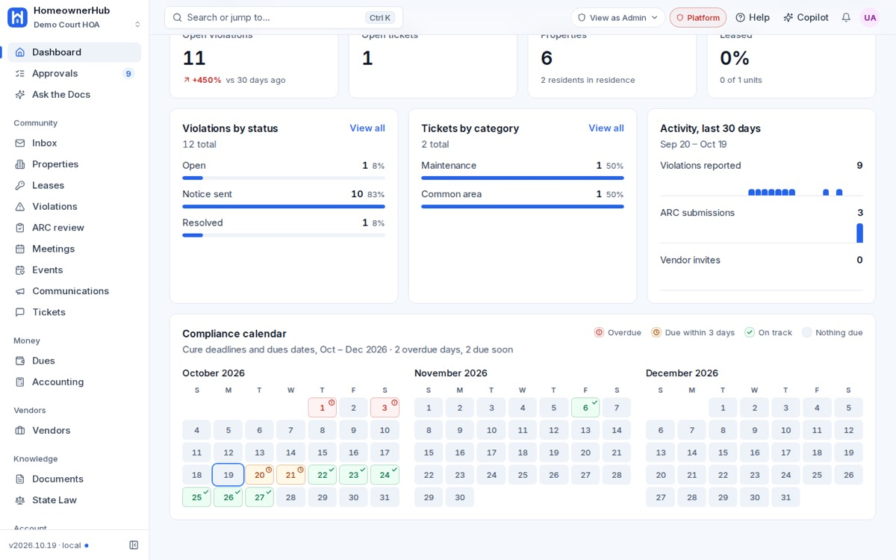
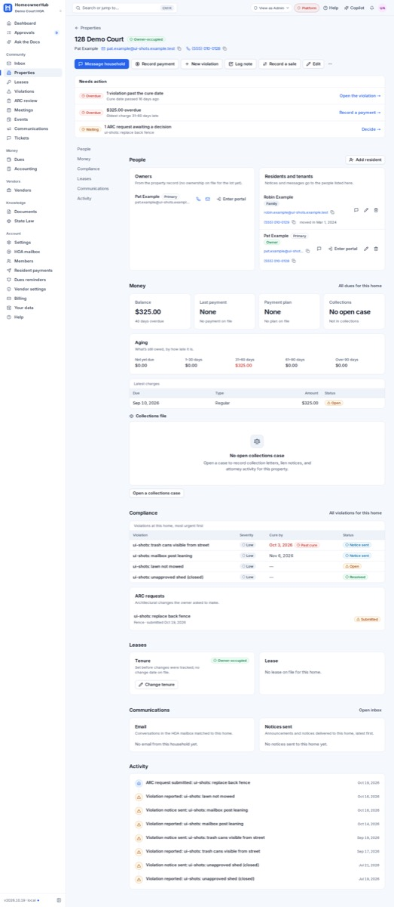
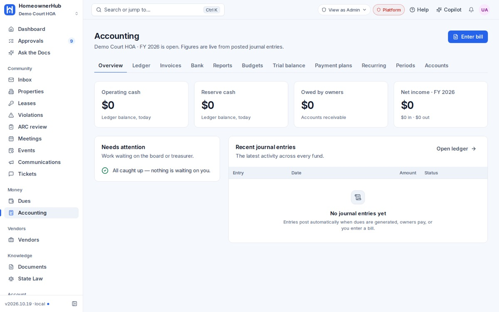

## Summary

Payment plans no longer count overdue charges twice. Every screen now shows its layout straight away and fills in as the data arrives.

## Fixes

### Payment plans
- **Choose what the plan replaces.** When you create a plan, you tick the overdue charges it replaces; past-due ones are ticked for you. The plan total is what's still open on those charges.
- **No double counting.** The replaced charges are closed in the same step, so the owner's balance stays the same and income is counted once.
- **Month-end dates are right.** A plan that starts on the 31st now falls on the last day of shorter months; it no longer skips a month. The same fix applies to monthly dues.
- **Older plans are flagged.** Plans created before today show a note asking you to check that the original charges were closed.

### Speed
- **Instant layout.** Every page shows its layout immediately, with grey placeholders while data loads.
- **Section-by-section loading.** The dashboard, Approvals and Accounting now load one section at a time, so one slow section no longer holds up the whole page.
- **Fewer round trips.** Violation pages and the resident portal make fewer trips to the database.
- **Settings member count fixed.** The Settings page now counts only your own association's members.

### Website
- **Unverified quotes removed.** We removed customer quotes we couldn't verify, and all contact addresses now use support@homeownerledger.com.

## Screenshots

