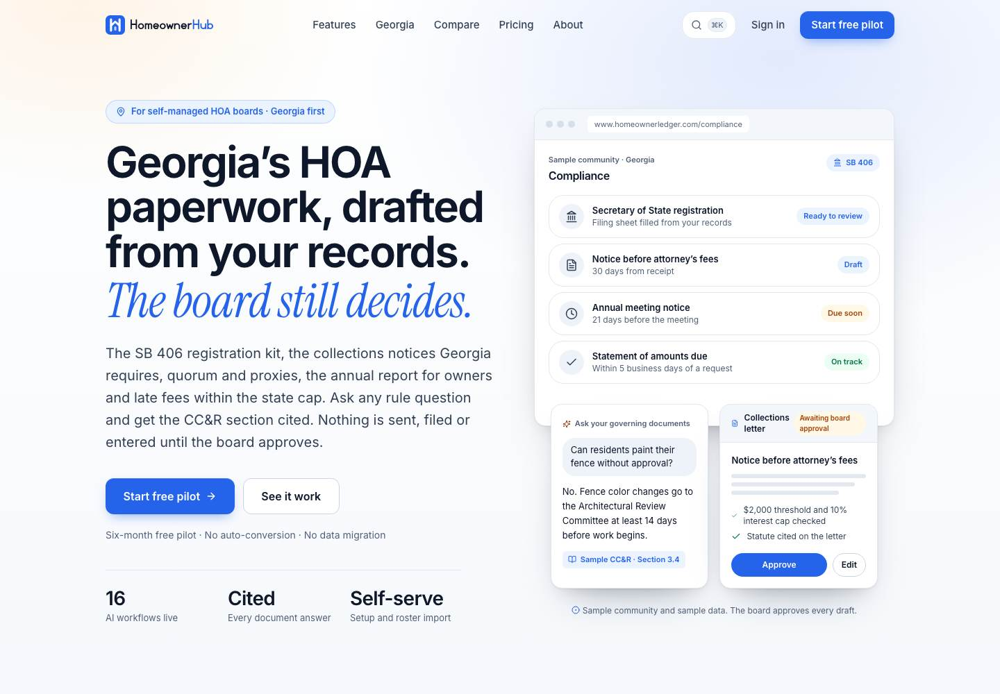
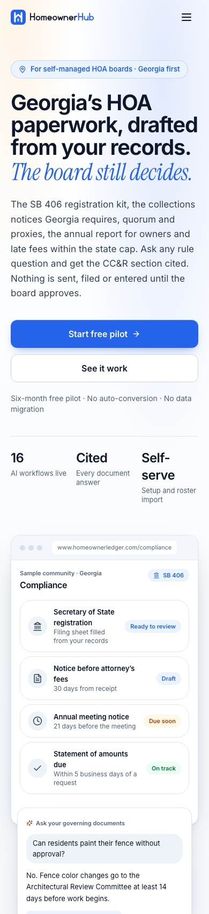
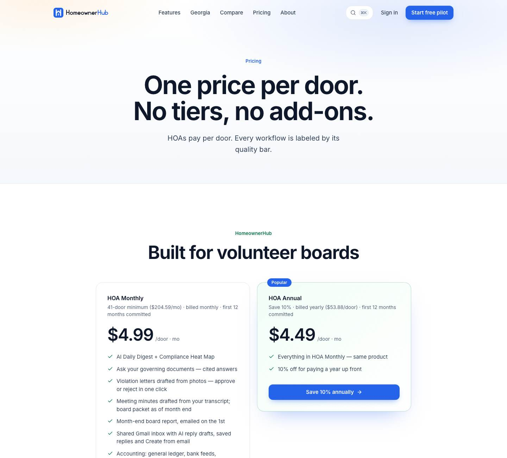

## Summary

The marketing website at www.homeownerledger.online has been redesigned from top to bottom: a clear Georgia-first message, a realistic product picture, a shorter home page and a clean phone layout. In the app, Georgia condominium associations now follow the Georgia Condominium Act wherever it differs from the HOA law. The Georgia law text the app quotes now includes the 2025 and 2026 code corrections. And a website bug that silently lost demo requests is fixed.

## What's new

### Website
- New home page: "Georgia's HOA paperwork, drafted from your records. The board still decides." The product picture is built from real app screens (sample data).
- New look on Features (/hoa), Pricing, About, Compare (cards on phones instead of a cramped table) and Demo, plus a new header, footer and phone menu.
- Stock photos and repeated sections removed; the home page is much shorter.

### Georgia condominiums
- For an association marked as a condominium, the app follows the Georgia Condominium Act:
  - statement of amounts due within 5 business days;
  - 21 days' notice of the annual meeting;
  - the condo notice before foreclosure (30 days, $2,000 floor);
  - late-fee and interest caps;
  - insurance minimums ($1M liability, replacement-cost property cover).
- The complaint pause and the payment-order card from SB 406 also apply to condominiums.

### Georgia law text
- The Georgia HOA law text now includes the 2025 and 2026 code revisions (for example, an annual meeting "may be called" by 5% of owners).

## Fixes

- The website's demo form told visitors their request was sent even when it couldn't be. It now asks them to email support@homeownerledger.com instead, until the email setting (OA-34) is added.

## Needs your action

- OA-34 (urgent): add the email settings to the marketing project so demo requests reach you.
- OA-35: turn on website analytics and Google Search Console.
- OA-33: re-enter the Stripe test webhook secret.
