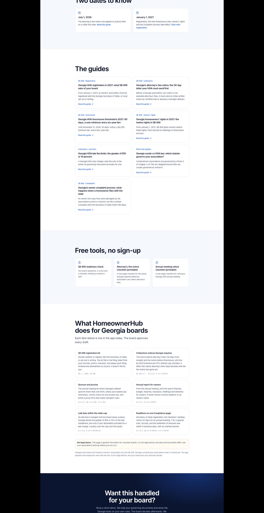
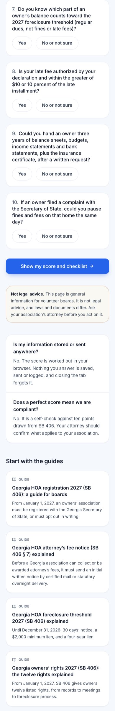

## Summary

The website now has a Georgia SB 406 hub, seven in-depth guides, two free printable checklists, and a 3-minute "Is your HOA ready for SB 406?" check. These pages are built to rank in Google for what Georgia boards are searching before January 1, 2027, and each one ends with "Book a demo". The demo form also asks two optional questions (county and number of homes) and promises a reply within one business day.

## What's new

### New pages on www.homeownerledger.online
- `/georgia`: the SB 406 hub ("Get your HOA ready for SB 406 before January 1").
- Guides:
  - `/georgia/registration-2027`
  - `/georgia/attorney-fee-notice`
  - `/georgia/foreclosure-threshold-2027`
  - `/georgia/owners-rights-2027`
  - `/georgia/late-fee-limits`
  - `/georgia/condo-vs-hoa-law`
  - `/georgia/complaint-process`
- Free printable checklists: `/georgia/attorney-fee-notice-checklist` and `/georgia/annual-meeting-notice-checklist`.
- `/georgia/readiness`: ten yes/no questions, scored in the browser. Nothing is stored or sent.

Every law quote comes word for word from the official text, and tests check each one.

### Getting demo requests
- "Book a demo" is in the header and at the end of every page.
- Visitor analytics are ready (demo clicks, pilot clicks, demo requests), with no personal data. They start counting once analytics is turned on (OA-35).
- Google can index the pages once Search Console is set up (OA-35).
- The home page loads faster.

## Needs your action

- OA-34 (urgent): add the email settings to the marketing project. Until then, demo requests can't reach you.
- OA-35: turn on Vercel Analytics, add the site to Google Search Console, and send Claude the verification value.
