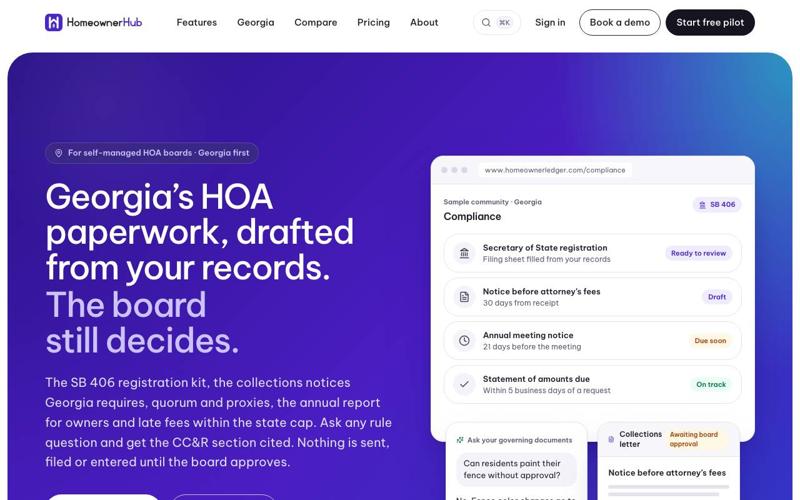
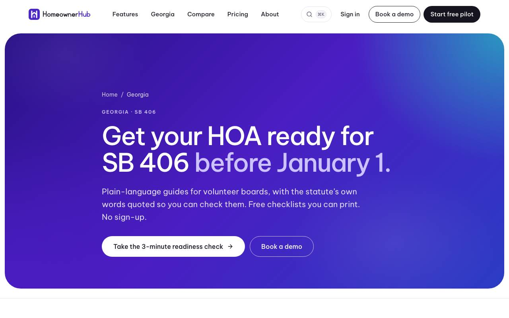
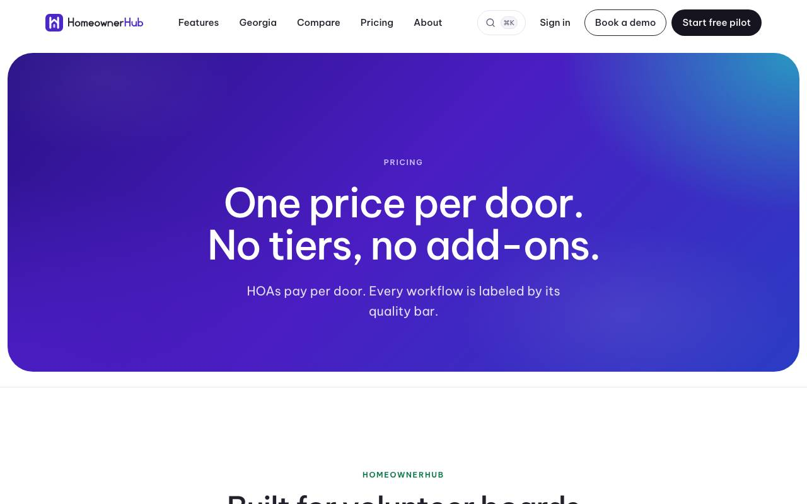

## Summary

Boards can now send a community announcement (a Halloween party, happy holidays, a graduation reminder, pet rules, a pool opening) in about three clicks. Pick an occasion or type one sentence, check the draft, and send. The dashboard also suggests the next occasion when one is coming up. Separately, the marketing website has a new look, inspired by modern enterprise software sites: a deep violet gradient, rounded panels and pill buttons. The content and the Georgia guides are unchanged.

## What's new

### Community announcements
- A **New announcement** button on Messages, Inbox and the dashboard.
- 16 ready occasions in English and Spanish:
  - **Holidays:** Halloween party, happy holidays, New Year, Fourth of July, Thanksgiving.
  - **Reminders:** graduation (congratulations and parking), pet waste and leash rules, trash or bulk-pickup changes, watering.
  - **Community:** pool opening and closing, yard sale, holiday lights contest.
  - **Notices:** annual meeting reminder, severe weather.
- Or type one sentence, such as "Halloween party Oct 31 at 6pm at the clubhouse". The date, time and place are filled in for you, and everything stays editable.
- One review screen shows the email and text previews, with "All residents" or chosen streets. Send now or schedule.
- Nothing goes out until a board member clicks Send. Residents' opt-outs and channel choices are respected. Texts go only to residents who opted in, and they are off by default except for severe weather.
- **Seasonal suggestions:** the dashboard and daily digest suggest the next occasion ("Halloween is Friday: send a party notice?"). You can dismiss them.

### Website
- A new look across every page: a violet-to-blue hero panel, a dark "Start free pilot" button, rounded cards, and the Be Vietnam Pro typeface.
- Contrast meets accessibility standards. Content, SEO data and "Book a demo" buttons are unchanged.

## Needs your action

- OA-34 (urgent): add the email settings to the marketing project so demo requests reach you.
- OA-35: website analytics and Google Search Console.
- OA-36: three read-only checks for the tenant-isolation audit.
