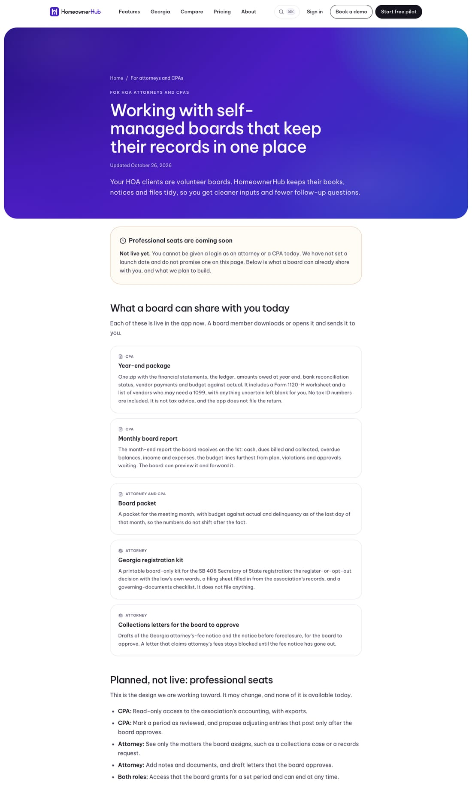
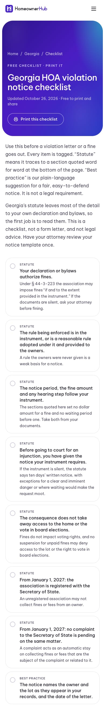

## Summary

This release hardens the walls between associations, adds a Settings page where an admin can see and change the association's state and type, and publishes five more free guides and templates on the website.

## What's new

### Settings → Association
- An admin can now view and edit the association's name, **state**, **type** (HOA, condominium, co-op), and governing-law state. Board members can see these settings but not change them.
- Before a state or type change is saved, a "What changes" box lists the rules that switch: for example, Georgia SB 406 tools turn off and Florida rules turn on. You confirm before anything is saved, and every change is logged.
- The setup checklist links to it: "Confirm your state and association type".

### Website: new free guides and templates
- `/georgia/violation-notice-checklist`: printable; each item is marked as either a statute requirement (quoted word for word) or best practice.
- `/templates/hoa-board-meeting-agenda`: printable, for any state, with Georgia notes.
- `/georgia/self-managed-hoa-georgia-first-90-days`: a guide.
- `/guides/hoa-treasurer-duties`: a guide.
- `/professionals`: for HOA attorneys and CPAs. Their own accounts are marked "coming soon, not live yet". It also lists what a board can already share with them.

## Security

A security audit checked that one association can never see or change another's data. Everyday reads were already sealed. This release closes the gaps the audit found in background work and sign-ins:
- **Email:** it can only go out from the association's own connected Gmail. Connecting Gmail is now tied to your own browser session, and only admins can do it.
- **Books:** bank reconciliation, recurring journal entries, Plaid bank syncs and ticket notices can only touch the association's own records.
- **Login:** a link can no longer send you to an outside site after you sign in.
- **Files:** resident uploads and download links are limited to the association's own files.
- **Next step:** a database update (OA, coming next) adds the same protection at the database level.

## Needs your action

- OA-34 (urgent): add the email settings to the marketing project so demo requests reach you.
- OA-26 (now Soon): set the dedicated signing secrets.
- OA-36: three read-only checks for the security audit.
