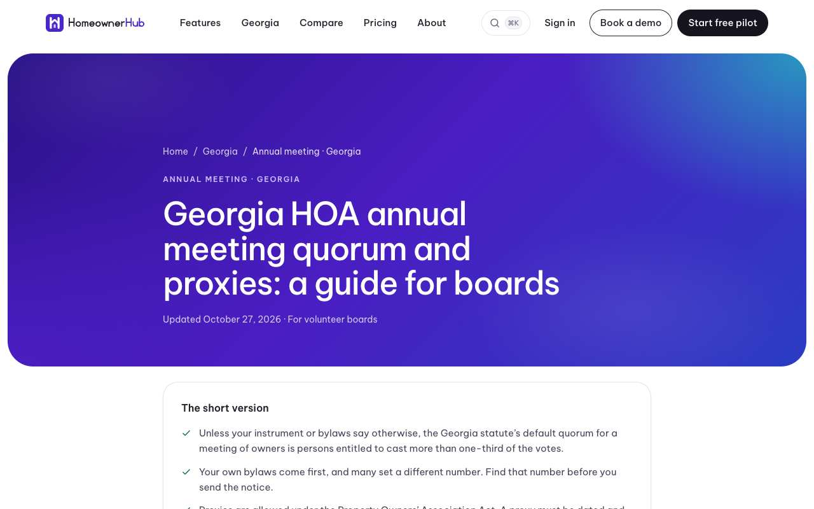
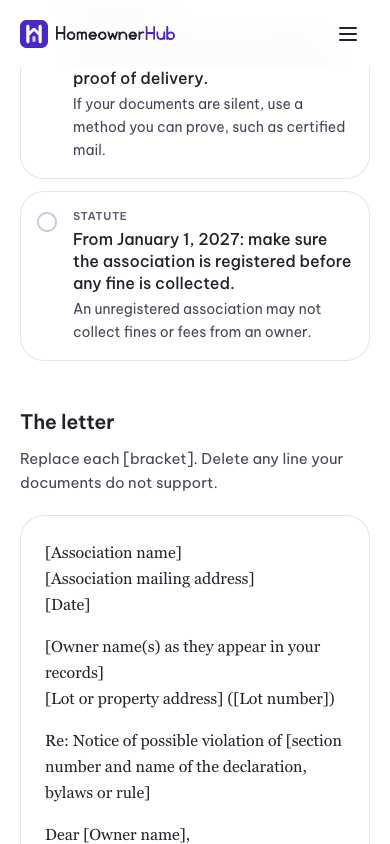

## Summary

The website has three new in-depth guides for Georgia boards and one free, printable violation letter template. They cover annual meeting quorum and proxies, owners' records requests, and fines and violation hearings. Each quotes the statute word for word, says plainly where the law we hold is silent, and ends with "Book a demo".

## What's new

### New pages on www.homeownerledger.online
- `/georgia/annual-meeting-quorum-proxies`: the default quorum, proxy rules for property owners' associations and Georgia nonprofits, and a check-in routine.
- `/georgia/records-inspection-requests`: what the Nonprofit Code says now, what SB 406 adds on January 1, 2027, and how a board can respond.
- `/georgia/fines-and-violation-hearings`: where the power to fine comes from, why Georgia's statute does not itself require a hearing, and a fair process.
- `/templates/hoa-violation-letter-georgia`: a printable first-notice letter with a check-before-you-send list. Every fine amount and response period is a blank for your own documents.

The Georgia hub and the related guides now link to all four.

## Under the hood

- Every new law quote is checked word for word against the official text, and the page titles and descriptions pass the weekly SEO audit.
