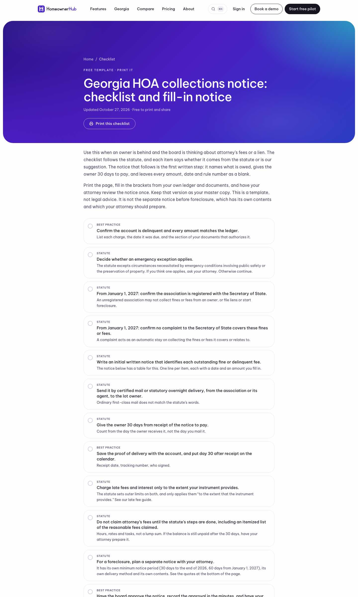
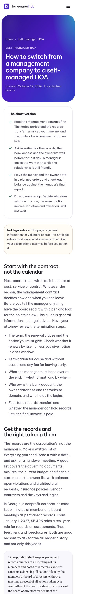

## Summary

The website has four new pages. Two are free, printable templates, and two are guides. Each says it is not legal advice, quotes Georgia law word for word where it quotes it at all, and ends with "Book a demo".

## What's new

### New pages on www.homeownerledger.online
- `/templates/georgia-hoa-collections-notice`: a checklist and a fill-in notice for an owner who is behind. It follows the Georgia attorney's-fee notice rule and the foreclosure notice text. Every amount and date is a blank.
- `/templates/hoa-board-meeting-minutes`: a printable minutes form that works in any state, with Georgia notes in a labelled section at the bottom.
- `/guides/switch-from-management-company-to-self-managed-hoa`: a step-by-step plan for leaving a management company. It points to the features that exist today: the roster import, the CINC aging import, the bank statement import and the setup checklist.
- `/georgia/special-assessments`: what counts as a special assessment, how an unpaid one becomes a lien, the 2027 payment order, and what Georgia's statute leaves to your own documents. We had the law text for it, so we built this page rather than the budget and reserves page.

The Georgia hub and the related guides now link to all four.

## Under the hood

- Every new law quote is checked word for word against the official text, and titles and descriptions pass the weekly SEO audit.
