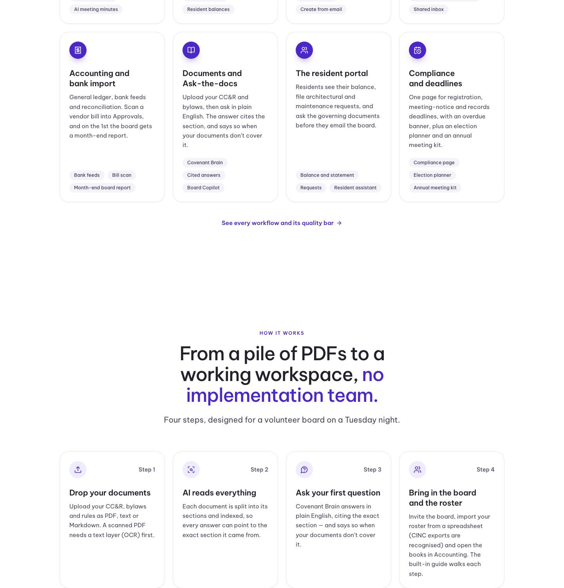

## Summary

The homeownerledger.online website now opens with what HomeownerHub is: an AI workspace for self-managed HOA boards, where AI drafts and the board approves. State law support (Georgia first, then Florida, California and Texas) is now one supporting section instead of the headline.

## What's new

- New home page headline: "The AI workspace for self-managed HOA boards. The board still decides."
- The top image now shows the product itself: the approvals queue, a cited answer from the governing documents, and a violation letter awaiting approval.
- The home page walks through eight product areas first (AI drafting, dues, violations, announcements, accounting, documents, resident portal, deadlines). After that comes one "State law built in" section with Georgia first.
- A new State laws page lists all four states. The menu and footer now say "State laws" instead of "Georgia".
- The HOA page leads with "Run your HOA without a management company".
- The Georgia guides, templates and readiness check are unchanged and still linked.

## Needs your action

- OA-34 (urgent): add the email settings so website demo requests reach you.
- OA-37: apply the two database updates (0070, then 0071). We're doing this together now.
