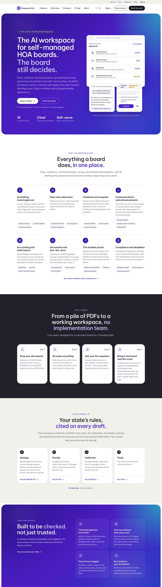

## Summary

Your board can now give a CPA or an attorney their own limited, time-boxed access, and route money approvals through a Treasurer. Payments that cover several charges post in one step, and any overpayment is kept as a credit. The dashboard now suggests a community message before national holidays. Behind the scenes, your associations are now kept apart inside the database itself, not only in the app.

## What's new

### Professional and officer roles
- **Settings → Professionals:** invite a CPA or an attorney by a signed, single-use link. Each invitation has an end date, at most a year.
- **A CPA** sees the books read-only, with owner names only (no email, phone or address).
- **An attorney** sees only the collections cases, violations and records requests you assign.
- **Officer titles:** you can set President, Treasurer, Secretary and others. An optional "two board members must approve" amount applies to money items.

### Payments and collections
- **Record payment** posts every part of a payment at once. If any part fails, nothing is posted. Money paid beyond what is owed is kept as a **credit** on the home's page and the owner's ledger.
- **Certified-mail tracking:** on a Georgia collections letter, record how it was mailed, the tracking number and the delivery date. Fee and foreclosure clocks then count from the delivery day.

### Dashboard and residents
- **Holiday and event suggestions:** the dashboard card now covers 20 dates a year, including MLK Day, Presidents' Day, Juneteenth, Veterans Day, Mother's and Father's Day, Happy Holidays, New Year and both daylight-saving clock changes. Big events show 10 to 14 days ahead. One tap opens a ready draft, and nothing is sent until a board member approves it.
- **Georgia late-fee prompt:** Georgia boards with no late-fee policy see a short card quoting the law, linking to Settings → Late fees.
- **Board and emergency contacts:** the board can publish up to 8 contacts (manager, gate, after-hours) on residents' home screen.
- **Message language:** residents can choose "Spanish only" on their account page. Everyone else keeps getting both languages.
- **Annual meeting report:** the board's own write-up is now saved. A checkbox adds the report under the annual meeting notice.

### Website (homeownerledger.online)
- A closer match to a modern enterprise look: a top utility bar, larger headlines, dark and warm section bands, and a full-width dark footer.
- Three new guide pages: AI HOA violation letters (draft, then approve); AI HOA meeting minutes from a transcript; HOA announcement templates for boards.
- Demo requests from the website now reach your inbox.

## Under the hood

- **Database-level tenant isolation:** 121 links between records now refuse to point across associations.

## Needs your action

- **Settings → Professionals:** set your Treasurer under Officers, then invite your CPA or attorney when you're ready.
- **OA-35:** turn on website analytics and Search Console.
